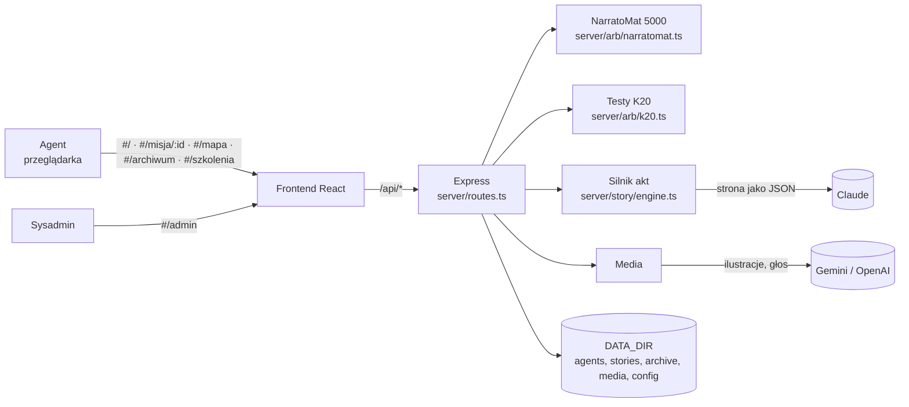

# Architektura

Jeden proces Node (Express) obsługuje API gry, panel admina i frontend React (w dev przez Vite, w produkcji jako statyczny build). Dane trzymane są w plikach JSON w `DATA_DIR`.



## 1. Struktura repozytorium

```
server.ts                    Start: createApp() + Vite (dev) albo statyczny dist/ (prod)
server/
  app.ts                     Express: nagłówki, JSON, /api/health, routery, /media, błędy
  routes.ts                  Publiczne API: agenci, NarratoMat, misje, szkolenia, notatki, archiwum, media
  admin.ts                   Panel admina: hasło, konfiguracja, test kluczy, próby na żywo
  config.ts                  Konfiguracja (zod) w DATA_DIR/config.json, klucze (panel > env)
  media.ts                   Dostawca ilustracji i głosu, styl ilustracji ARB
  providers/                 Klienci Anthropic, Gemini, OpenAI
  arb/
    agents.ts                Zapis agentów, zegar (kofeina, stres, limity), automat do kawy
    narratomat.ts            Przydział misji: punktacja + K20 (20 = wybór, 1 = paradoks)
    k20.ts                   Test K20: modyfikatory z nazwami, DC, wynik
    archive.ts               Lista wpisów według poziomu dostępu, komentarze (DATA_DIR/archive)
  story/
    engine.ts                Schemat strony, rozmowa z Claude, normalizacja, act(), settle()
    prompt.ts                Prompt systemowy Narratoriusza (stały per misja + język, cache'owany)
    twists.ts                Sekrety misji: tylko na serwerze, nie trafiają do przeglądarki
    store.ts                 Zapis akt i plików mediów, ochrona ścieżek
shared/
  arb.ts                     Katalog: rangi, sekcje, departamenty, typy misji, 18 misji, mapa, mini-gry
  archive.ts                 36 wpisów Biblioteki (serwowane przez API, nie importowane przez frontend)
  types.ts                   Agent, Story, Page, Stats, RollResult, MissionOffer
src/
  App.tsx                    Router na hashu, rekrutacja lub ekrany agenta
  agent.ts                   useAgent(): agent z serwera, id przepustki w localStorage
  desk.ts                    Pogoda, Zegar Tempus Fugit, Plotkarski Telegraf (deterministyczne per dzień)
  screens/                   Recruitment, Dashboard, Mission, Training, MapScreen, ArchiveScreen, Admin
  games/                     Fasolki, Labirynt, Smok, Kalambury, Alchemia
  components/                Shell, Cat (Mrucz-Term), D20, MultiverseMap, Effects
tests/                       Vitest: katalog, K20, NarratoMat, silnik, API (sztuczny Anthropic)
```

## 2. Tura misji

```mermaid
sequenceDiagram
  participant A as Agent
  participant API as routes.ts
  participant E as engine.ts
  participant C as Claude
  A->>API: POST /story/:id/act {pageId, choiceId | custom}
  API->>E: act(story, agent, …)
  E->>E: pieczątka? (koszt 1) · ryzykowny ruch? → rollTest() K20
  E->>C: system (misja, cache) + ostatnie 6 stron + STATE + „K20 TEST: … → WYNIK”
  C-->>E: JSON strony (narracja, Kot, wybory, delty, dowody, zakończenie)
  E->>E: toPage(): przycięcie delt, max 1 pieczątka, koniec przy spójności 0 lub ostatniej stronie
  API->>API: settle(): stres i kofeina → agent; zakończenie → XP i rekord historii (raz)
  API-->>A: {page, story, agent}
```

Zasada: **kod rzuca, model opowiada.** Wynik testu jest przesyłany jako ostateczny, a model nie może go zmienić.

## 3. Reguły

- **K20:** `die + modyfikator` vs `DC = 8 + 2 × trudność (+2 przy paradoksie)`. 20 to krytyczny sukces, 1 krytyczna porażka. Wynik ≥ DC to sukces, do 3 poniżej DC sukces częściowy, niżej porażka. Modyfikatory: ranga (+indeks), sekcja zgodna z misją (+2), procedura (+2) / dyplomacja (+1), stres > 70 (−2), kofeina 0 (−1).
- **Ryzyko:** wybór oznaczony przez model jako `risky` i każdy własny ruch. Procedury bez ryzyka i pieczątki nie rzucają.
- **XP:** misja `(40 + 20 × trudność) × mnożnik zakończenia` (1,2 tajne akta · 1 uratowana · 0,6 z przypisami · 0,3 paradoks · 0,15 DKW). Szkolenie `min(15, wynik/10 + 5 za rekord)`.
- **Rangi i dostęp:** 0, 120, 350, 800, 1600 i 3000 XP to poziomy dostępu 0–5 w Bibliotece.
- **Zegar agenta:** kofeina −1 co 6 min, stres −1 co 15 min, 2 przelosowania dziennie, oferta ważna 8 h.

## 4. Dane

`DATA_DIR/agents/<id>.json` (agent), `stories/<id>.json` (akta), `archive/comments.json` (max 50 komentarzy na wpis), `media/<storyId>/…`, `config.json` (0600). Identyfikatory to UUID-y sprawdzane wyrażeniem regularnym przed użyciem w ścieżce.
