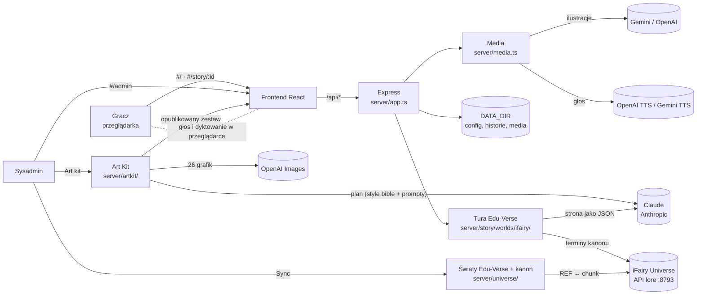
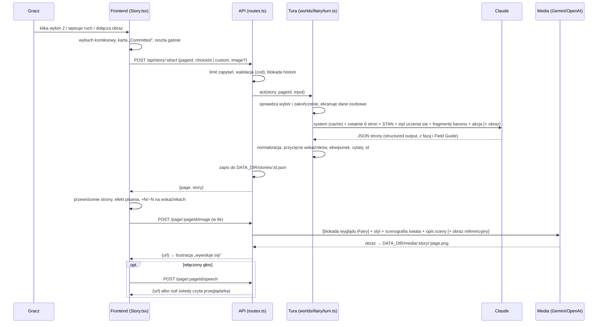
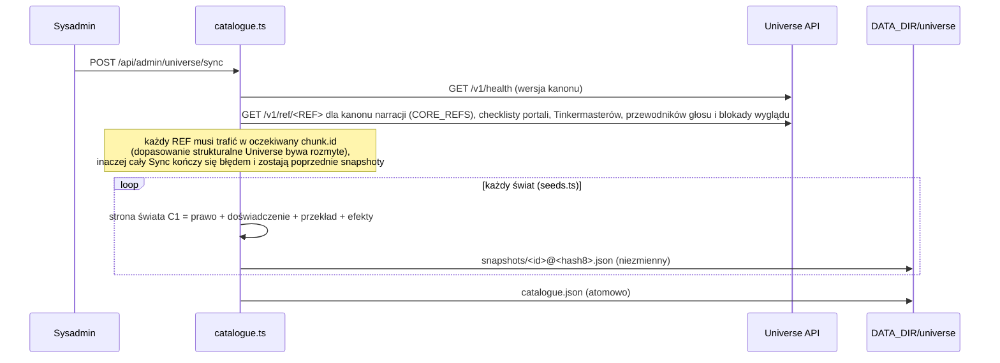
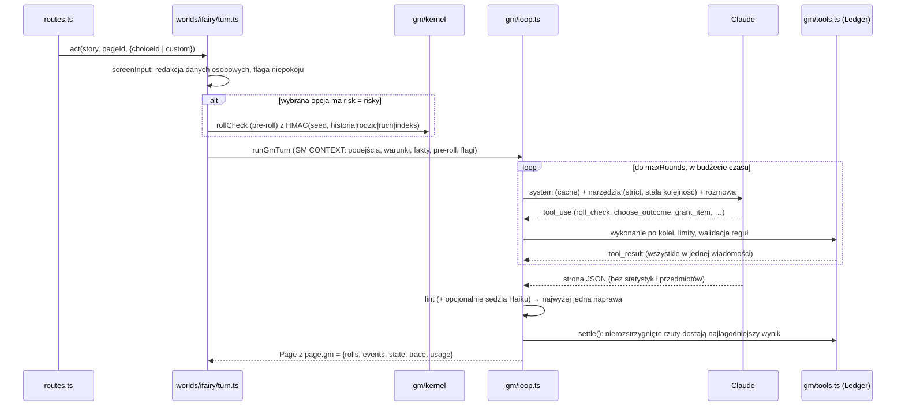
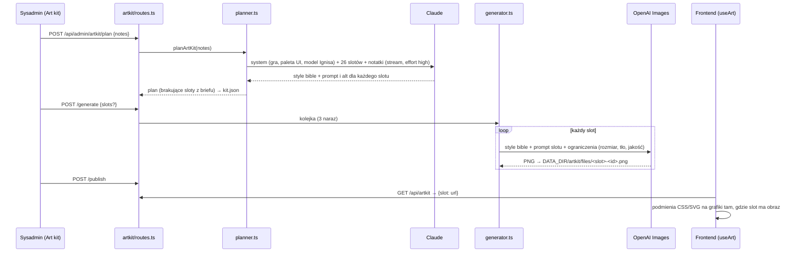

# Architektura

**IGNIS // iFairy Quantum Edu-Verse** to interaktywna gra edukacyjna „wybierz własną drogę” osadzona w kanonie iFairy Universe. Ignis, skrzydlata cyber-księga, prowadzi Młodego Odkrywcę przez portale do światów o innych prawach natury według modelu 3 faz (wejście, przekład na naukę naszego świata, personalizacja). Źródło projektu: [QUANTUM_EDUVERSE.md](QUANTUM_EDUVERSE.md).

- **Światy** są autorskie (`server/universe/seeds.ts`): Siedem Światów (ścieżka etapami), sześć Cyber-Magicznych Laboratoriów i Portal Zadań Domowych.
- **Kanon iFairy** (reguły narracji i bezpieczeństwa, humor, canon lock, wygląd iFairies, checklista portali, Tinkermasterzy i przewodnicy głosu, lore na żywo) przychodzi z API lore iFairy Universe; Sync zamraża każdy świat razem z tym kanonem.
- Wycofane w 6.0: świat Grimm Protocol i 40 przygód z kanonu. Ich zapisane historie serwer archiwizuje (410).

Jeden proces Node (Express) obsługuje API gry, panel admina i frontend React (w dev przez Vite, w produkcji jako statyczny build).



---

## 1. Struktura repozytorium

```
.
├── server.ts                  Punkt startowy: createApp() + Vite (dev) albo statyczny dist/ (prod)
├── server/
│   ├── app.ts                 Aplikacja Express: nagłówki, JSON, /api/health, routery, /media, obsługa błędów
│   ├── routes.ts              Publiczne API gry: światy, podróże, akcje, cofanie, kolejny etap, ilustracje, głos, limity, archiwum
│   ├── admin.ts               API panelu admina: autoryzacja, konfiguracja, test kluczy i listy modeli, testy na żywo
│   ├── config.ts              Konfiguracja (zod) w DATA_DIR/config.json, klucze (panel > zmienna środowiskowa), maskowanie
│   ├── media.ts               Wybór dostawcy ilustracji i głosu, styl ilustracji, mapowanie błędów dostawców
│   ├── artkit/
│   │   ├── planner.ts         Claude jako dyrektor artystyczny: style bible + prompt na slot; składanie promptu obrazu
│   │   ├── generator.ts       Kolejka renderów OpenAI (3 naraz), publikacja i cofnięcie publikacji
│   │   ├── store.ts           Stan art kitu (DATA_DIR/artkit/kit.json) i pliki obrazów, sprzątanie
│   │   └── routes.ts          Publiczne /api/artkit, /artkit/*, /favicon.png, /og.png; API panelu art kitu
│   ├── providers/
│   │   ├── anthropic.ts       Klient Claude, lista modeli, czytelne błędy SDK
│   │   ├── gemini.ts          Lista modeli, ilustracje (z obrazem referencyjnym), TTS (PCM → WAV)
│   │   ├── openai.ts          Lista modeli, ilustracje (gpt-image / DALL·E), TTS (mp3)
│   │   └── types.ts           ModelInfo, Media, ProviderError, czyszczenie komunikatów błędów
│   ├── gm/
│   │   ├── kernel/rng.ts      Kości z HMAC(seed, historia|rodzic|ruch|indeks), commit sha256 ziarna
│   │   ├── kernel/rules.ts    2d6 + podejście (siła), pasma, opcje wyniku jako dane, walidacja wyboru
│   │   ├── kernel/events.ts   Zdarzenia GM i czysty reduktor (meters, przedmioty, warunki, fakty, NPC, quest, czas, zegary)
│   │   ├── kernel/quests.ts   Szkielety questów per łuk nauki (3 fazy, zadanie domowe), cele przekształcone, zegary
│   │   ├── tools.ts           Narzędzia GM (strict), limity na stronę, Ledger zamieniający wywołania w zdarzenia
│   │   ├── loop.ts            Pętla narzędzi: rundy, termin, ostatnia runda bez narzędzi, lint i naprawa, sędzia Haiku, probe
│   │   ├── safety.ts          Redakcja danych osobowych, flaga niepokoju, lint strony (bogowie, pytania o dane, kontrakt wyborów)
│   │   └── audit.ts           Audyt historii: kości z ziarna, stan = rodzic + zdarzenia
│   ├── universe/
│   │   ├── client.ts          Klient API lore (klucz, grant, timeouty), searchCanonSafe: cache 10 min, nigdy nie rzuca błędem
│   │   ├── terms.ts           Lista dozwolonych terminów kanonu; z niej (i tylko z niej) składa się zapytanie o lore
│   │   ├── seeds.ts           Światy Edu-Verse (prawo, doświadczenie, przekład, efekty, obsada, sekrety) + kanon narracji (CORE_REFS)
│   │   ├── catalogue.ts       Sync: kanon (REF → oczekiwany chunk) + strona świata → snapshot z hashem
│   │   ├── store.ts           DATA_DIR/universe: catalogue.json i niezmienne snapshoty światów (tylko Edu-Verse)
│   │   ├── pii.ts             Wzorce danych osobowych z guardu Universe (imię bohatera iFairy)
│   │   └── admin.ts           API panelu: status, test (health + prawdziwe wyszukiwanie), sync, podgląd promptu
│   └── story/
│       ├── engine.ts          Wspólne: StoryError, PlayerAction, pick(), pathTo(), test modelu w panelu
│       ├── public.ts          publicStory(): przeglądarka dostaje tylko kartę świata, nie materiał promptu
│       ├── store.ts           Zapis historii (pamięć + JSON na dysku) i plików mediów, ochrona ścieżek
│       └── worlds/ifairy/
│           ├── prompt.ts      Prompt Ignisa (filozofia, 3 fazy, profil dla dzieci) wyłącznie ze snapshotu (cache per świat + język)
│           ├── humour.ts      Przykłady humoru Ignisa (poprzeczka, nie szablon)
│           ├── page.ts        Schemat strony i normalizacja (siły, opcja C, faza, Field Guide, bez śmierci)
│           └── turn.ts        Start podróży, akcja, styl uczenia się, lore na żywo w ostatniej turze, kolejny etap
├── shared/
│   ├── artkit.ts              Katalog 26 slotów graficznych (brief, miejsce użycia, rozmiar, przezroczystość) i typy art kitu
│   ├── types.ts               Typy wspólne dla serwera i klienta: Story, Page, Choice, Stats, Phase, Force, PublicStory
│   └── universe.ts            Typy światów: AdventureCard, AdventureSnapshot, CanonPassage, NpcCard, isEduverse()
├── src/                       Frontend (React 19, Tailwind 4, motion)
│   ├── main.tsx               Start: MotionConfig (ograniczenie ruchu), podświetlenie za kursorem
│   ├── App.tsx                Router oparty na hash, ekrany ładowane na żądanie, śnieg, powiadomienia
│   ├── api.ts                 Klient HTTP API gry i admina, zapamiętane rozgrywki (localStorage)
│   ├── artkit.ts              useArt(): opublikowany art kit (slot → URL), pobierany raz na wczytanie strony
│   ├── ui.tsx                 System komponentów: Button, IconButton, Badge, Meter, Segmented, Sheet, Toast, Logo, SnowToggle
│   ├── meta.ts                Siły jako sposoby uczenia się, fazy, zakończenia, teksty czytnika, okładki, „x min ago”
│   ├── prefs.ts               Przełącznik śniegu (localStorage + useSyncExternalStore)
│   ├── index.css              Tokeny motywu (@theme), konteksty drewno / papier, komponenty CSS, animacje
│   ├── components/
│   │   ├── SVGCharacter.tsx   Ignis: księga-robot z ekranem CRT, nastroje, skrzydła, mówienie
│   │   ├── Effects.tsx        ComicBurst, EmberSparks, StringLights, Snow, Equalizer, RuneLoader
│   │   └── TimelineMap.tsx    Drzewo forków z cofaniem
│   └── screens/
│       ├── Home.tsx           Edu-Verse: Ignis, 3 fazy, imię, język i sposób uczenia się, światy / laby / portal zadań, zapisane podróże
│       ├── Story.tsx          Czytnik: strona z fazą, Field Guide, wybory, własne słowa i zdjęcie, ilustracja, głos, zakończenia, kolejny etap, Codex, skróty
│       ├── Admin.tsx          Konsola sysadmina
│       ├── ArtKitPanel.tsx    Sekcja „Art kit”: plan, render, podgląd, edycja promptów, publikacja
│       └── UniversePanel.tsx  Sekcja „iFairy Universe”: adres, grant, klucz, test, sync światów, podgląd promptu Ignisa
├── tests/                     Vitest: strona i kontekst, konfiguracja, dostawcy, API, Universe, Edu-Verse, GM, art kit (sztuczne Anthropic, OpenAI, Universe)
├── docs/                      Ta dokumentacja, OPERATORZY.md i QUANTUM_EDUVERSE.md (źródło projektu)
├── .github/workflows/ci.yml   CI: typecheck, testy, build
└── data/ (gitignored)         Tworzony w runtime: config.json, stories/, media/, artkit/, universe/
```

---

## 2. Przebieg jednej tury



Najważniejsze decyzje:
- **Stan gry trzyma serwer.** Klient wysyła tylko `pageId` + `choiceId` albo tekst własnego ruchu, więc nie może podrobić odpowiedzi modelu ani statystyk.
- **Tekst nie czeka na ilustrację.** Obraz i głos generują się osobnymi wywołaniami w tle.
- **Koszt kontekstu jest stały:** Claude dostaje tylko ostatnie 6 stron, a starsze trafiają do kontekstu jako streszczenie, które model sam aktualizuje co stronę. Prompt systemowy jest stały dla pary świat + język, więc trafia do cache'a.
- **Gałęzie są tanie:** każda strona zapisuje pełny stan (wskaźniki, ekwipunek, fazę, notatkę Field Guide), więc cofnięcie to tylko przesunięcie wskaźnika `currentPageId`. Błąd to nowa gałąź rzeczywistości.

---

## 2a. Edu-Verse: Sync i tura

**Sync** (panel → „iFairy Universe” → *Sync now*) zamraża każdy świat razem z kanonem:



**Tura** (`POST /api/story/:id/act` → `worlds/ifairy/turn.ts`):
1. `buildLoreQuery()` składa do 8 terminów z listy dozwolonych: terminy znalezione w ruchu gracza, scena z poprzedniej strony i kotwice świata. Imię, surowy tekst gracza ani wolny tekst modelu nigdy nie trafiają do Universe (Universe wysyła zapytanie do zewnętrznego modelu embeddingów).
2. `searchCanonSafe()` (limit 1,5 s, cache 10 min, próg 0,35) zwraca fragmenty z uchwytami L1–L4. Przy awarii Universe tura idzie dalej bez fragmentów.
3. Claude dostaje prompt systemowy zbudowany wyłącznie ze snapshotu świata (Ignis, filozofia wielu światów, profil dla dzieci, humor, canon lock, checklista portali, łuk nauki, strona świata C1 i kanon C2…), a fragmenty L tylko w ostatniej turze gracza, w `<canon_excerpts>`, razem ze stylem uczenia się. Dzięki temu prompt systemowy jest identyczny przez całą podróż i trafia do cache'a.
4. `toIfairyPage()` normalizuje stronę: wybory A/B z siłą (`logos` · `mythos` · `gnosis` · `phantasia`), opcja C jako `freeForm`, faza (`entry` · `translation` · `personalisation`), notatka Field Guide, zakończenia tylko `canon` · `subverted` · `secret`, a `lore_refs` zamieniają się w cytaty `Page.lore` (nieznane uchwyty odpadają).

Podróż przypina pełny snapshot świata (`Story.adventure`), `maxDepth` i styl uczenia się (`Story.style`) przy starcie, więc ponowny Sync nigdy nie zmienia trwającej podróży. Przeglądarka dostaje przez `publicStory()` tylko kartę świata. Historie bez `world: "ifairy"` albo z rodzajem spoza Edu-Verse (`saga`, `hook`, `district`) są archiwalne: `routes.ts` zwraca dla nich 410.

---

## 2b. AI Game Master

Włączany w panelu (*Game Master*), działa tylko dla podróży rozpoczętych, gdy jest włączony (`Story.gm`). Zasada: **kod decyduje, model opowiada**.



- **Mechanika:** 2d6 + podejście (najsilniejsza siła +2, pozostałe +1), ryzyko ±1, warunki −1, suma modyfikatorów −2..+3. 10+ jasny sukces (korzyść), 7–9 sukces z kosztem (koszt + korzyść), 6− zwrot akcji (ruch GM, nigdy porażka). Opcje wyniku i ich efekty są danymi w `rules.ts`.
- **Brak narzędzia = brak skutku:** schemat strony GM nie ma pól statystyk ani ekwipunku. Każda zmiana to zdarzenie z narzędzia, a `fold(stan rodzica, zdarzenia)` musi dać zapisany stan (sprawdza to audyt).
- **Uczciwe kości:** ziarno jest tylko na serwerze (`Story.gmSecret`), przeglądarka dostaje jego sha256 (`gmCommit`). Ten sam ruch po cofnięciu daje te same kości.
- **Cache:** narzędzia i prompt systemowy są stałe (kolejność renderowania: narzędzia → system → wiadomości), drugi breakpoint stoi na końcu tury gracza. Wiadomości w turze są tylko dopisywane (zachowane bloki thinking).
- **NPC:** karty w snapshocie (obsada świata z imionami + 12 Tinkermasterów + 4 przewodników głosu z kanonu). Relacje affinity / trust / respect (−3..3), pamięć z ważnością (8 najważniejszych), autorskie sekrety światów ujawniane tylko przez `reveal_secret` przy odpowiednim zaufaniu. Tekst sekretu nie trafia do promptu, dopóki nie zostanie ujawniony.
- **Quest, konsekwencje, świat:** szkielet celów zależny od łuku nauki (`three-phase`: portal, eksperyment, wzór, przekład jako kulminacja, „zrób to po swojemu”; `homework`: pokaż, zrozum, krok, rozwiązanie jako kulminacja, wyjaśnij), cele zamknięte, nieudane albo przekształcone. Zaplanowane konsekwencje odpalają się jako zdarzenia kernela na stronie, na którą przypadają. Każda strona to pora dnia dalej; zegary zagrożeń i plotki (prawdziwość widzi tylko GM). Notatki reżysera w GM CONTEXT pilnują tempa; zakończenie `canon` wymaga zamkniętej kulminacji.
- **Ścieżka Siedmiu Światów:** `POST /api/story/:id/next-chapter` po zakończeniu świata (rodzaj `world`) tworzy podróż do kolejnego etapu z przeniesionymi podejściami, więziami, faktami, przedmiotami i stylem uczenia się (`Story.campaign`, stan startowy w `Story.gmStart`). Laby i portal zadań nie są ścieżką (400).
- **Budżet:** `gm.turnBudgetMs` (domyślnie 75 s) przy nginx `proxy_read_timeout` 180 s; poniżej 20 s następna runda idzie z `tool_choice: none`, poniżej 8 s tura kończy się 502 bez zapisu.

---

## 3. Art Kit: jak powstaje szata graficzna



**26 slotów** (`shared/artkit.ts`): scena warsztatu z portalem, Ignis (poza bohatera, Ignis malujący), 14 okładek światów (`cover-<id świata>`), 4 ikony sił, 3 odznaki zakończeń, znak marki i karta do udostępniania. Każdy slot zna swoje miejsce w interfejsie, więc plan uwzględnia kadrowanie (okładki są przycinane do paska) i czytelność w małym rozmiarze (ikony 44 px).

---

## 4. Model danych (`shared/types.ts`)

| Typ | Pola kluczowe | Uwagi |
|---|---|---|
| `Story` | `id`, `taleId` (id świata), `lang`, `heroName`, `timeline`, `rootPageId`, `currentPageId`, `pages`, `world: "ifairy"`, `adventure`, `maxDepth`, `style` | Wszystkie strony wszystkich gałęzi w jednej mapie. Brak `world` albo rodzaj spoza Edu-Verse = archiwum (410) |
| `Page` | `parentId`, `depth`, `action`, `narration`, `quip`, `mood`, `choices`, `ending`, `stats`, `inventory`, `summary`, `imagePrompt`, `imageUrl`, `audioUrl`, `lore`, `freeForm`, `scene`, `phase`, `fieldNote`, `safety`, `gm` | Pełny stan po tej stronie |
| `Choice` | `id`, `label`, `kind` (`logos` · `mythos` · `gnosis` · `phantasia`), `risk?` | `id` nadaje serwer; siła to zarazem sposób uczenia się |
| `Stats` | `chaos` = Dysonans 0..100, `karma` = Harmonia −100..100, `mana` = Etherium 0..100 | Start: 0 / 0 / 60. Nazwy pól zostały z pierwszej wersji gry |
| `PageGm` (`shared/gm.ts`) | `rolls` (kości, modyfikatory, pasmo, wybrane opcje, `streamKey`), `events`, `state` (podejścia, warunki, fakty, NPC, quest, świat), `trace`, `usage` | Tylko podróże z Game Masterem; fakty `gm_only` nie wychodzą do przeglądarki |
| `AdventureSnapshot` (`shared/universe.ts`) | karta (`id`, `kind`: `world` · `lab` · `homework`, `order`, `emoji`, `hue`, `title`, `tagline`, `structure`: `three-phase` · `homework`, `version`) + `premise`, `setting`, `cast`, `loreTerms`, `art`, `sources` (C-uchwyty: C1 strona świata, dalej kanon), `checklist`, `canonVersion`, `hash`, `npcs`, `imageLock` | Zamrożony przy Sync, przypięty do podróży przy starcie |

**Zasady gry pilnowane po stronie serwera** (`toIfairyPage` / `toGmPage` / `ifairyAct`):
- zmiana każdego wskaźnika to najwyżej ±25 na stronę (z Game Masterem tylko przez zdarzenia narzędzi);
- najwyżej 3 wybory (z Game Masterem 2 z różnymi siłami), a przy zakończeniu żadnych i bez opcji C;
- typ wyboru to jedna z czterech sił, faza jedna z trzech; zakończenia spoza `canon` · `subverted` · `secret` zamieniają się w `canon`;
- ekwipunek ma najwyżej 12 unikalnych przedmiotów, a obraz dołączony przez gracza dopisuje się jako `🖼 opis`;
- wartości spoza listy (nastrój, siła, faza, typ zakończenia) zamieniają się w bezpieczną wartość domyślną, więc strona nie wysypuje się z ich powodu.

---

## 5. Gdzie leżą dane

| Miejsce | Zawartość |
|---|---|
| `DATA_DIR/config.json` (prawa 600) | Ustawienia z panelu i klucze zapisane w panelu |
| `DATA_DIR/stories/<id>.json` | Pełne historie (cache w pamięci + zapis na dysk); historie z wycofanych światów zostają, ale nie są serwowane |
| `DATA_DIR/media/<storyId>/<pageId>.png\|mp3\|wav` | Wygenerowane ilustracje i nagrania, serwowane pod `/media/...` |
| `DATA_DIR/artkit/kit.json` | Plan art kitu, stan każdego slotu, opublikowany zestaw |
| `DATA_DIR/artkit/files/*.png` | Grafiki art kitu, serwowane pod `/artkit/...` z cache „immutable” |
| `DATA_DIR/universe/catalogue.json` | Wynik ostatniego Sync: wersja kanonu, bieżący snapshot każdego świata, raport |
| `DATA_DIR/universe/snapshots/<id>@<hash8>.json` | Niezmienne snapshoty światów (trzymane są 3 ostatnie na świat) |
| `localStorage` gracza | `ignis.runs` (do 20 podróży; lista pokazuje tylko podróże Edu-Verse), `ignis.lang`, `ignis.hero`, `ignis.force` (sposób uczenia się), `ignis.snow` |
| `sessionStorage` sysadmina | `ignis.adminPw` (tylko na czas karty) |

---

## 6. Frontend

- **Routing przez hash:** `#/` to ekran główny, `#/story/:id` czytnik, `#/admin` konsola. Czytnik i konsola ładują się na żądanie.
- **Dwa konteksty kolorów, te same tokeny:**
  - domyślny to *drewniana ściana* (jasny tekst na ciemnym tle);
  - klasy `.card` / `.paper` przełączają te same tokeny (`--color-ink`, `--color-surface`, …) na *papier* (ciemny tekst na kremowym tle).
  
  Dzięki temu komponent działa w obu miejscach bez wariantów.
- **Animacje:**
  - `motion` obsługuje przejścia stron, wskaźniki, listy, panele i powiadomienia;
  - czyste CSS obsługuje wybuchy komiksowe, iskry, lampki, śnieg i kominek;
  - SMIL (animacje wewnątrz SVG) obsługuje twarz i skrzydła Ignisa, który narruje każdy świat.
  
  Wszystko respektuje systemowe ograniczenie ruchu.
- **Skróty w czytniku:** `1`–`4` wybór, `/` własny ruch, `M` mapa linii czasu, `V` czytanie na głos, `Spacja` pominięcie animacji tekstu.
- **Jeden świat:** strona główna pokazuje światy, gdy Edu-Verse jest włączony i zsynchronizowany, a inaczej kartę „The portals are still closed”. Teksty czytnika, siły jako sposoby uczenia się, fazy i zakończenia są w `src/meta.ts`, a kolory sił w tokenach `--color-logos` / `-mythos` / `-gnosis` / `-phantasia`.
