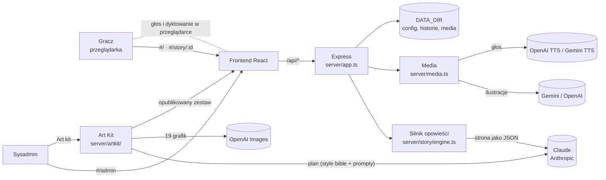
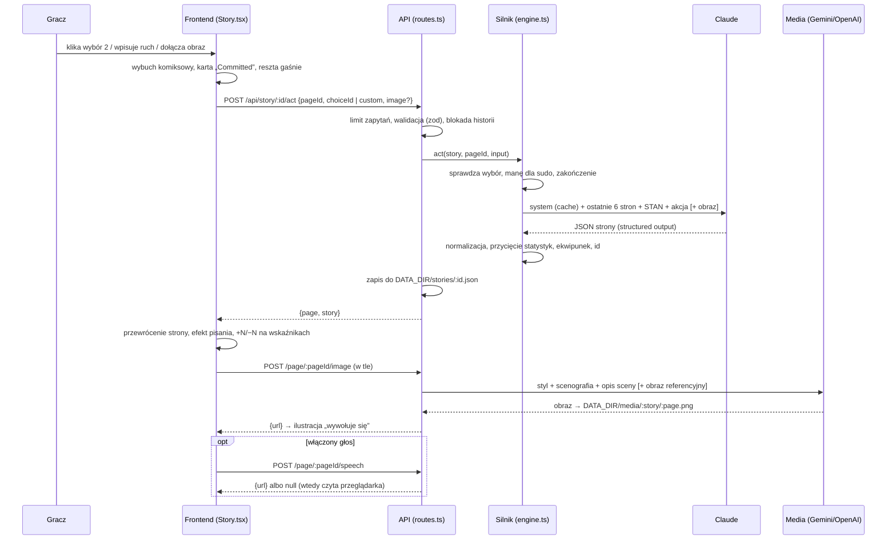
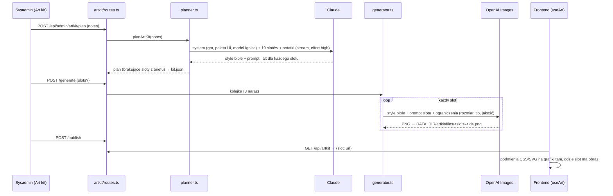

# Architektura

**IGNIS // OS: Grimm Protocol** to gra „wybierz własną przygodę” (CYOS) dla widzów w stylu *Ricka i Morty'ego*. Klasyczne baśnie są tu zabugowanym kodem, a narrator Ignis to sarkastyczna księga-robot.

Jeden proces Node (Express) obsługuje API gry, panel admina i frontend React (w dev przez Vite, w produkcji jako statyczny build).



---

## 1. Struktura repozytorium

```
.
├── server.ts                  Punkt startowy: createApp() + Vite (dev) albo statyczny dist/ (prod)
├── server/
│   ├── app.ts                 Aplikacja Express: nagłówki, JSON, /api/health, routery, /media, obsługa błędów
│   ├── routes.ts              Publiczne API gry: baśnie, historie, akcje, cofanie, ilustracje, głos, limity
│   ├── admin.ts               API panelu admina: autoryzacja, konfiguracja, test kluczy i listy modeli, testy na żywo
│   ├── config.ts              Konfiguracja (zod) w DATA_DIR/config.json, klucze (panel > zmienna środowiskowa), maskowanie
│   ├── media.ts               Wybór dostawcy ilustracji i głosu, styl ilustracji, mapowanie błędów dostawców
│   ├── artkit/
│   │   ├── planner.ts         Claude jako dyrektor artystyczny: style bible + prompt na slot; składanie promptu obrazu
│   │   ├── generator.ts       Kolejka renderów OpenAI (3 naraz), publikacja i cofnięcie publikacji
│   │   ├── store.ts           Stan art kitu (DATA_DIR/artkit/kit.json) i pliki obrazów, sprzątanie
│   │   └── routes.ts          Publiczne /api/artkit, /artkit/*, /favicon.png, /og.png; API panelu art kitu
│   ├── providers/
│   │   ├── anthropic.ts       Klient Claude, lista modeli, czytelne błędy SDK
│   │   ├── gemini.ts          Lista modeli, ilustracje (z obrazem referencyjnym), TTS (PCM → WAV)
│   │   ├── openai.ts          Lista modeli, ilustracje (gpt-image / DALL·E), TTS (mp3)
│   │   └── types.ts           ModelInfo, Media, ProviderError, czyszczenie komunikatów błędów
│   └── story/
│       ├── engine.ts          Silnik: schemat strony, kontekst dla Claude, wywołanie, normalizacja, start i akcje
│       ├── prompts.ts         Prompt systemowy narratora (stały dla pary baśń + język, więc cache'owany)
│       └── store.ts           Zapis historii (pamięć + JSON na dysku) i plików mediów, ochrona ścieżek
├── shared/
│   ├── artkit.ts              Katalog 19 slotów graficznych (brief, miejsce użycia, rozmiar, przezroczystość) i typy art kitu
│   ├── types.ts               Typy wspólne dla serwera i klienta: Story, Page, Choice, Stats, Tale, PublicConfig
│   └── tales.ts               Katalog baśni: twist, kanoniczne momenty, obsada, scenografia ilustracji, kolor okładki
├── src/                       Frontend (React 19, Tailwind 4, motion)
│   ├── main.tsx               Start: MotionConfig (ograniczenie ruchu), podświetlenie za kursorem
│   ├── App.tsx                Router oparty na hash, ekrany ładowane na żądanie, śnieg, powiadomienia
│   ├── api.ts                 Klient HTTP API gry i admina, zapamiętane rozgrywki (localStorage)
│   ├── artkit.ts              useArt(): opublikowany art kit (slot → URL), pobierany raz na wczytanie strony
│   ├── ui.tsx                 System komponentów: Button, IconButton, Badge, Meter, Segmented, Sheet, Toast, Logo, SnowToggle
│   ├── meta.ts                Kolory i etykiety typów wyborów i zakończeń, okładki, „x min ago”
│   ├── prefs.ts               Przełącznik śniegu (localStorage + useSyncExternalStore)
│   ├── index.css              Tokeny motywu (@theme), konteksty drewno / papier, komponenty CSS, animacje
│   ├── components/
│   │   ├── SVGCharacter.tsx   Ignis: księga-robot z ekranem CRT, nastroje, skrzydła, mówienie
│   │   ├── Effects.tsx        ComicBurst, EmberSparks, StringLights, Snow, Equalizer, RuneLoader
│   │   └── TimelineMap.tsx    Drzewo forków z cofaniem
│   └── screens/
│       ├── Home.tsx           Wybór baśni, imię i język, zapisane rozgrywki
│       ├── Story.tsx          Czytnik: strona, wybory, własny ruch, ilustracja, głos, zakończenia, skróty
│       ├── Admin.tsx          Konsola sysadmina
│       └── ArtKitPanel.tsx    Sekcja „Art kit”: plan, render, podgląd, edycja promptów, publikacja
├── tests/                     Vitest: silnik, konfiguracja, dostawcy, API (na sztucznym serwerze Anthropic)
├── docs/                      Ta dokumentacja i OPERATORZY.md
├── .github/workflows/ci.yml   CI: typecheck, testy, build
└── data/ (gitignored)         Tworzony w runtime: config.json, stories/, media/
```

---

## 2. Przebieg jednej tury



Najważniejsze decyzje:
- **Stan gry trzyma serwer.** Klient wysyła tylko `pageId` + `choiceId` albo tekst własnego ruchu, więc nie może podrobić odpowiedzi modelu ani statystyk.
- **Tekst nie czeka na ilustrację.** Obraz i głos generują się osobnymi wywołaniami w tle.
- **Koszt kontekstu jest stały:** Claude dostaje tylko ostatnie 6 stron, a starsze trafiają do kontekstu jako streszczenie, które model sam aktualizuje co stronę. Prompt systemowy jest stały dla pary baśń + język, więc trafia do cache'a.
- **Forki są tanie:** każda strona zapisuje pełny stan (statystyki, kanon, ekwipunek), więc cofnięcie to tylko przesunięcie wskaźnika `currentPageId`.

---

## 3. Art Kit: jak powstaje szata graficzna



**19 slotów** (`shared/artkit.ts`): scena warsztatu, Ignis (poza bohatera, Ignis malujący), 5 okładek baśni, 4 ikony typów wyboru, 5 odznak zakończeń, znak marki i karta do udostępniania. Każdy slot zna swoje miejsce w interfejsie, więc plan uwzględnia kadrowanie (okładki są przycinane do paska) i czytelność w małym rozmiarze (ikony 44 px).

---

## 4. Model danych (`shared/types.ts`)

| Typ | Pola kluczowe | Uwagi |
|---|---|---|
| `Story` | `id`, `taleId`, `lang`, `heroName`, `timeline`, `rootPageId`, `currentPageId`, `pages` | Wszystkie strony wszystkich gałęzi w jednej mapie |
| `Page` | `parentId`, `depth`, `action`, `narration`, `quip`, `mood`, `choices`, `ending`, `stats`, `canon`, `inventory`, `summary`, `imagePrompt`, `imageUrl`, `audioUrl` | Pełny stan po tej stronie |
| `Choice` | `id`, `label`, `kind` (`sane` · `chaos` · `dumb` · `sudo`) | `id` nadaje serwer |
| `Stats` | `chaos` 0..100, `karma` −100..100, `mana` 0..100 | Start: 0 / 0 / 60, kanon 100 |
| `Tale` | `twist`, `beats`, `cast`, `art`, `tech`, `hue`, `title`/`tagline` (pl/en) | Klient dostaje tylko część do wyświetlenia |

**Zasady gry pilnowane po stronie serwera** (`toPage` / `act`):
- zmiana każdej statystyki to najwyżej ±25 na stronę;
- kanon może spaść o 25 albo wzrosnąć o 10 na stronę;
- `sudo` kosztuje 20 many i jest odrzucane, gdy many brakuje;
- najwyżej 4 wybory, a przy zakończeniu żadnych;
- ekwipunek ma najwyżej 12 unikalnych przedmiotów, a obraz dołączony przez gracza dopisuje się jako `🖼 opis`;
- wartości spoza listy (nastrój, typ wyboru, typ zakończenia) zamieniają się w bezpieczną wartość domyślną, więc strona nie wysypuje się z ich powodu.

---

## 5. Gdzie leżą dane

| Miejsce | Zawartość |
|---|---|
| `DATA_DIR/config.json` (prawa 600) | Ustawienia z panelu i klucze zapisane w panelu |
| `DATA_DIR/stories/<id>.json` | Pełne historie (cache w pamięci + zapis na dysk) |
| `DATA_DIR/media/<storyId>/<pageId>.png\|mp3\|wav` | Wygenerowane ilustracje i nagrania, serwowane pod `/media/...` |
| `DATA_DIR/artkit/kit.json` | Plan art kitu, stan każdego slotu, opublikowany zestaw |
| `DATA_DIR/artkit/files/*.png` | Grafiki art kitu, serwowane pod `/artkit/...` z cache „immutable” |
| `localStorage` gracza | `ignis.runs` (do 20 rozgrywek), `ignis.lang`, `ignis.hero`, `ignis.snow` |
| `sessionStorage` sysadmina | `ignis.adminPw` (tylko na czas karty) |

---

## 6. Frontend

- **Routing przez hash:** `#/` to ekran główny, `#/story/:id` czytnik, `#/admin` konsola. Czytnik i konsola ładują się na żądanie.
- **Dwa konteksty kolorów, te same tokeny:**
  - domyślny to *drewniana ściana* (jasny tekst na ciemnym tle);
  - klasy `.card` / `.paper` przełączają te same tokeny (`--color-ink`, `--color-surface`, …) na *papier* (ciemny tekst na kremowym tle).
  
  Dzięki temu komponent działa w obu miejscach bez wariantów.
- **Animacje:**
  - `motion` obsługuje przejścia stron, wskaźniki, listy, panele i powiadomienia;
  - czyste CSS obsługuje wybuchy komiksowe, iskry, lampki, śnieg i kominek;
  - SMIL (animacje wewnątrz SVG) obsługuje twarz i skrzydła Ignisa.
  
  Wszystko respektuje systemowe ograniczenie ruchu.
- **Skróty w czytniku:** `1`–`4` wybór, `/` własny ruch, `M` mapa linii czasu, `V` czytanie na głos, `Spacja` pominięcie animacji tekstu.
