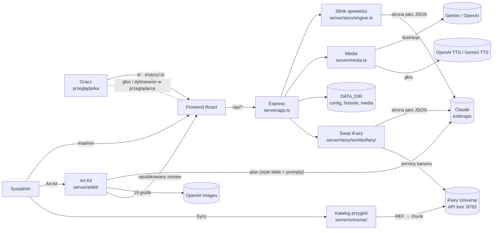
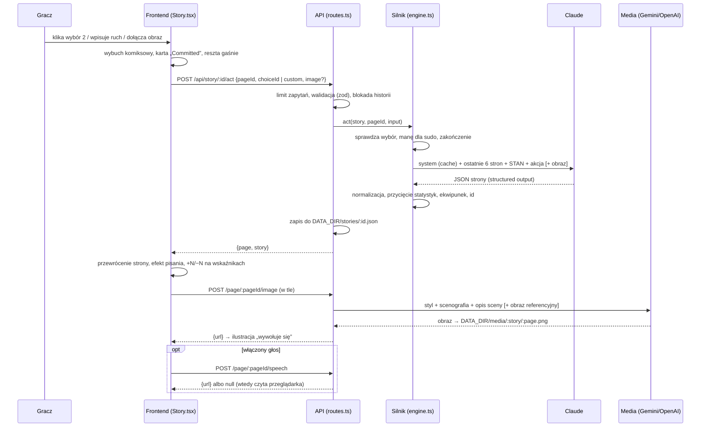
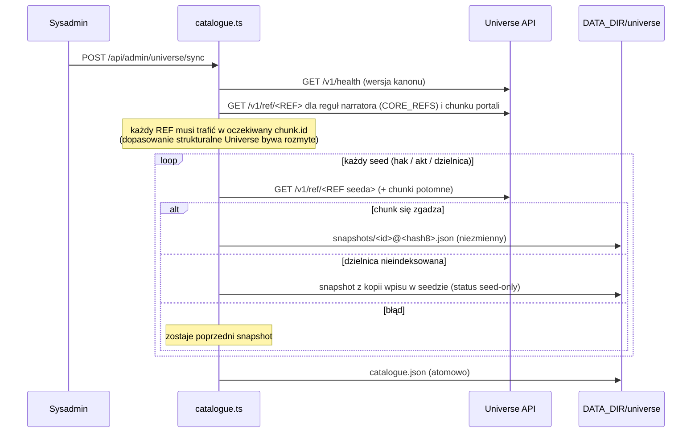
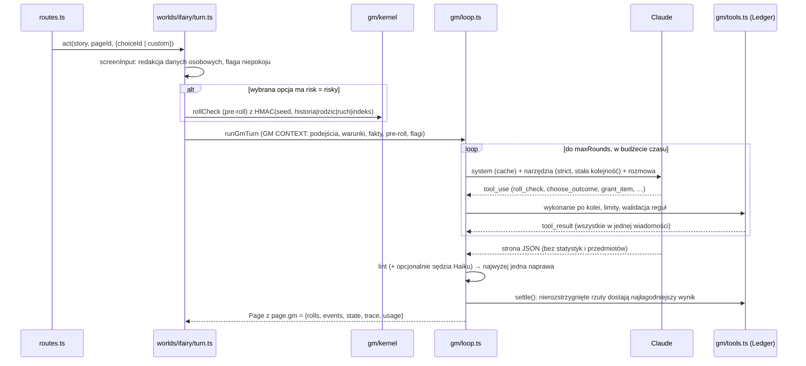
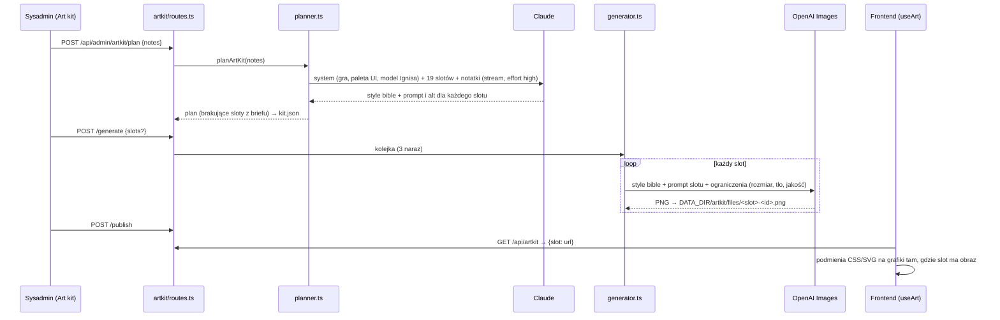

# Architektura

**IGNIS // OS: Grimm Protocol** to gra „wybierz własną przygodę” (CYOS) z dwoma światami:
- **Grimm Protocol** (16+): klasyczne baśnie jako zabugowany kod, narrator Ignis to sarkastyczna księga-robot w stylu *Ricka i Morty'ego*;
- **iFairy Universe** (13+): przygody z kanonu iFairy (haki z portali, Saga If-AI, Dzielnice Podróżników), które opowiada Narrator-Archiwista z kanonu. Treść przychodzi z API lore iFairy Universe.

Świat Grimm działa dokładnie tak jak przed dodaniem drugiego świata; pilnuje tego test `tests/grimm-golden.test.ts`.

Jeden proces Node (Express) obsługuje API gry, panel admina i frontend React (w dev przez Vite, w produkcji jako statyczny build).



---

## 1. Struktura repozytorium

```
.
├── server.ts                  Punkt startowy: createApp() + Vite (dev) albo statyczny dist/ (prod)
├── server/
│   ├── app.ts                 Aplikacja Express: nagłówki, JSON, /api/health, routery, /media, obsługa błędów
│   ├── routes.ts              Publiczne API gry: baśnie, historie, akcje, cofanie, ilustracje, głos, limity
│   ├── admin.ts               API panelu admina: autoryzacja, konfiguracja, test kluczy i listy modeli, testy na żywo
│   ├── config.ts              Konfiguracja (zod) w DATA_DIR/config.json, klucze (panel > zmienna środowiskowa), maskowanie
│   ├── media.ts               Wybór dostawcy ilustracji i głosu, styl ilustracji, mapowanie błędów dostawców
│   ├── artkit/
│   │   ├── planner.ts         Claude jako dyrektor artystyczny: style bible + prompt na slot; składanie promptu obrazu
│   │   ├── generator.ts       Kolejka renderów OpenAI (3 naraz), publikacja i cofnięcie publikacji
│   │   ├── store.ts           Stan art kitu (DATA_DIR/artkit/kit.json) i pliki obrazów, sprzątanie
│   │   └── routes.ts          Publiczne /api/artkit, /artkit/*, /favicon.png, /og.png; API panelu art kitu
│   ├── providers/
│   │   ├── anthropic.ts       Klient Claude, lista modeli, czytelne błędy SDK
│   │   ├── gemini.ts          Lista modeli, ilustracje (z obrazem referencyjnym), TTS (PCM → WAV)
│   │   ├── openai.ts          Lista modeli, ilustracje (gpt-image / DALL·E), TTS (mp3)
│   │   └── types.ts           ModelInfo, Media, ProviderError, czyszczenie komunikatów błędów
│   ├── gm/
│   │   ├── kernel/rng.ts      Kości z HMAC(seed, historia|rodzic|ruch|indeks), commit sha256 ziarna
│   │   ├── kernel/rules.ts    2d6 + podejście (siła), pasma, opcje wyniku jako dane, walidacja wyboru
│   │   ├── kernel/events.ts   Zdarzenia GM i czysty reduktor (meters, przedmioty, warunki, fakty)
│   │   ├── tools.ts           Narzędzia GM (strict), limity na stronę, Ledger zamieniający wywołania w zdarzenia
│   │   ├── loop.ts            Pętla narzędzi: rundy, termin, ostatnia runda bez narzędzi, lint i naprawa, sędzia Haiku, probe
│   │   ├── safety.ts          Redakcja danych osobowych, flaga niepokoju, lint strony (bogowie, pytania o dane, kontrakt wyborów)
│   │   └── audit.ts           Audyt historii: kości z ziarna, stan = rodzic + zdarzenia
│   ├── universe/
│   │   ├── client.ts          Klient API lore (klucz, grant, timeouty), searchCanonSafe: cache 10 min, nigdy nie rzuca błędem
│   │   ├── terms.ts           Lista dozwolonych terminów kanonu; z niej (i tylko z niej) składa się zapytanie o lore
│   │   ├── seeds.ts           Kuratorowany katalog: 6 haków, 8 aktów sagi, 26 dzielnic + reguły narratora (CORE_REFS)
│   │   ├── catalogue.ts       Sync: REF → oczekiwany chunk, snapshoty z hashem, błąd zamyka tylko daną przygodę
│   │   ├── store.ts           DATA_DIR/universe: catalogue.json i niezmienne snapshoty przygód
│   │   ├── pii.ts             Wzorce danych osobowych z guardu Universe (imię bohatera iFairy)
│   │   └── admin.ts           API panelu: status, test (health + prawdziwe wyszukiwanie), sync, podgląd promptu
│   └── story/
│       ├── engine.ts          Silnik Grimm: schemat strony, kontekst dla Claude, wywołanie, normalizacja, start i akcje
│       ├── prompts.ts         Prompt systemowy Ignisa (stały dla pary baśń + język, więc cache'owany)
│       ├── public.ts          publicStory(): przeglądarka dostaje tylko kartę przygody, nie materiał promptu
│       ├── store.ts           Zapis historii (pamięć + JSON na dysku) i plików mediów, ochrona ścieżek
│       └── worlds/ifairy/
│           ├── prompt.ts      Prompt Archiwisty zbudowany wyłącznie ze snapshotu (cache per przygoda + język)
│           ├── page.ts        Schemat strony iFairy i normalizacja (siły jako typy wyborów, opcja C, bez śmierci)
│           └── turn.ts        Start przygody, akcja, lore na żywo w ostatniej turze gracza
├── shared/
│   ├── artkit.ts              Katalog 19 slotów graficznych (brief, miejsce użycia, rozmiar, przezroczystość) i typy art kitu
│   ├── types.ts               Typy wspólne dla serwera i klienta: Story, Page, Choice, Stats, Tale, World, PublicStory
│   ├── universe.ts            Typy przygód iFairy: AdventureCard, AdventureSnapshot, CanonPassage
│   └── tales.ts               Katalog baśni: twist, kanoniczne momenty, obsada, scenografia ilustracji, kolor okładki
├── src/                       Frontend (React 19, Tailwind 4, motion)
│   ├── main.tsx               Start: MotionConfig (ograniczenie ruchu), podświetlenie za kursorem
│   ├── App.tsx                Router oparty na hash, ekrany ładowane na żądanie, śnieg, powiadomienia
│   ├── api.ts                 Klient HTTP API gry i admina, zapamiętane rozgrywki (localStorage)
│   ├── artkit.ts              useArt(): opublikowany art kit (slot → URL), pobierany raz na wczytanie strony
│   ├── ui.tsx                 System komponentów: Button, IconButton, Badge, Meter, Segmented, Sheet, Toast, Logo, SnowToggle
│   ├── meta.ts                Kolory i etykiety typów wyborów i zakończeń, okładki, „x min ago”
│   ├── prefs.ts               Przełącznik śniegu (localStorage + useSyncExternalStore)
│   ├── index.css              Tokeny motywu (@theme), konteksty drewno / papier, komponenty CSS, animacje
│   ├── components/
│   │   ├── SVGCharacter.tsx   Ignis: księga-robot z ekranem CRT, nastroje, skrzydła, mówienie
│   │   ├── ArchivistAvatar.tsx Narrator-Archiwista: księga światła, kryształ pamięci, cztery siły
│   │   ├── Effects.tsx        ComicBurst, EmberSparks, StringLights, Snow, Equalizer, RuneLoader
│   │   └── TimelineMap.tsx    Drzewo forków z cofaniem
│   └── screens/
│       ├── Home.tsx           Przełącznik światów, baśnie albo przygody iFairy, imię i język, zapisane rozgrywki
│       ├── Story.tsx          Czytnik: strona, wybory, własny ruch, ilustracja, głos, zakończenia, Codex (iFairy), skróty
│       ├── Admin.tsx          Konsola sysadmina
│       ├── ArtKitPanel.tsx    Sekcja „Art kit”: plan, render, podgląd, edycja promptów, publikacja
│       └── UniversePanel.tsx  Sekcja „iFairy Universe”: adres, grant, klucz, test, sync, podgląd promptu
├── tests/                     Vitest: silnik, konfiguracja, dostawcy, API, Universe, świat iFairy, golden Grimma (sztuczne serwery Anthropic, OpenAI, Universe)
├── docs/                      Ta dokumentacja i OPERATORZY.md
├── .github/workflows/ci.yml   CI: typecheck, testy, build
└── data/ (gitignored)         Tworzony w runtime: config.json, stories/, media/, artkit/, universe/
```

---

## 2. Przebieg jednej tury



Najważniejsze decyzje:
- **Stan gry trzyma serwer.** Klient wysyła tylko `pageId` + `choiceId` albo tekst własnego ruchu, więc nie może podrobić odpowiedzi modelu ani statystyk.
- **Tekst nie czeka na ilustrację.** Obraz i głos generują się osobnymi wywołaniami w tle.
- **Koszt kontekstu jest stały:** Claude dostaje tylko ostatnie 6 stron, a starsze trafiają do kontekstu jako streszczenie, które model sam aktualizuje co stronę. Prompt systemowy jest stały dla pary baśń + język, więc trafia do cache'a.
- **Forki są tanie:** każda strona zapisuje pełny stan (statystyki, kanon, ekwipunek), więc cofnięcie to tylko przesunięcie wskaźnika `currentPageId`.

---

## 2a. Świat iFairy: Sync i tura

**Sync** (panel → „iFairy Universe” → *Sync now*) zamraża katalog przygód:



**Tura iFairy** idzie tą samą trasą co Grimm (`POST /api/story/:id/act`), ale `routes.ts` kieruje ją do `worlds/ifairy/turn.ts`:
1. `buildLoreQuery()` składa do 8 terminów z listy dozwolonych: terminy znalezione w ruchu gracza, scena z poprzedniej strony i kotwice przygody. Imię, surowy tekst gracza ani wolny tekst modelu nigdy nie trafiają do Universe (Universe wysyła zapytanie do zewnętrznego modelu embeddingów).
2. `searchCanonSafe()` (limit 1,5 s, cache 10 min, próg 0,35) zwraca fragmenty z uchwytami L1–L4. Przy awarii Universe tura idzie dalej bez fragmentów.
3. Claude dostaje prompt systemowy zbudowany wyłącznie ze snapshotu przygody (persona Archiwisty, profil 13+, canon lock, checklista portali, premise z uchwytami C1…), a fragmenty L tylko w ostatniej turze gracza, w `<canon_excerpts>`. Dzięki temu prompt systemowy jest identyczny przez całą historię i trafia do cache'a.
4. `toIfairyPage()` normalizuje stronę: wybory A/B z siłą (`logos` · `mythos` · `gnosis` · `phantasia`), opcja C jako `freeForm`, zakończenia tylko `canon` · `subverted` · `secret`, a `lore_refs` zamieniają się w cytaty `Page.lore` (nieznane uchwyty odpadają).

Historia iFairy przypina pełny snapshot przygody (`Story.adventure`) i `maxDepth` przy starcie, więc ponowny Sync nigdy nie zmienia trwającej historii. Przeglądarka dostaje przez `publicStory()` tylko kartę przygody.

---

## 2b. AI Game Master świata iFairy

Włączany w panelu (*Game Master*), działa tylko dla historii iFairy rozpoczętych, gdy jest włączony (`Story.gm`). Zasada: **kod decyduje, model opowiada**.



- **Mechanika:** 2d6 + podejście (najsilniejsza siła +2, pozostałe +1), ryzyko ±1, warunki −1, suma modyfikatorów −2..+3. 10+ jasny sukces (korzyść), 7–9 sukces z kosztem (koszt + korzyść), 6− zwrot akcji (ruch GM, nigdy porażka). Opcje wyniku i ich efekty są danymi w `rules.ts`.
- **Brak narzędzia = brak skutku:** schemat strony GM nie ma pól statystyk ani ekwipunku. Każda zmiana to zdarzenie z narzędzia, a `fold(stan rodzica, zdarzenia)` musi dać zapisany stan (sprawdza to audyt).
- **Uczciwe kości:** ziarno jest tylko na serwerze (`Story.gmSecret`), przeglądarka dostaje jego sha256 (`gmCommit`). Ten sam ruch po cofnięciu daje te same kości.
- **Cache:** narzędzia i prompt systemowy są stałe (kolejność renderowania: narzędzia → system → wiadomości), drugi breakpoint stoi na końcu tury gracza. Wiadomości w turze są tylko dopisywane (zachowane bloki thinking).
- **Budżet:** `gm.turnBudgetMs` (domyślnie 75 s) przy nginx `proxy_read_timeout` 180 s; poniżej 20 s następna runda idzie z `tool_choice: none`, poniżej 8 s tura kończy się 502 bez zapisu.

---

## 3. Art Kit: jak powstaje szata graficzna



**19 slotów** (`shared/artkit.ts`): scena warsztatu, Ignis (poza bohatera, Ignis malujący), 5 okładek baśni, 4 ikony typów wyboru, 5 odznak zakończeń, znak marki i karta do udostępniania. Każdy slot zna swoje miejsce w interfejsie, więc plan uwzględnia kadrowanie (okładki są przycinane do paska) i czytelność w małym rozmiarze (ikony 44 px).

---

## 4. Model danych (`shared/types.ts`)

| Typ | Pola kluczowe | Uwagi |
|---|---|---|
| `Story` | `id`, `taleId`, `lang`, `heroName`, `timeline`, `rootPageId`, `currentPageId`, `pages`; iFairy: `world`, `adventure`, `maxDepth` | Wszystkie strony wszystkich gałęzi w jednej mapie. Brak `world` = Grimm (historie sprzed 4.3) |
| `Page` | `parentId`, `depth`, `action`, `narration`, `quip`, `mood`, `choices`, `ending`, `stats`, `canon`, `inventory`, `summary`, `imagePrompt`, `imageUrl`, `audioUrl`; iFairy: `lore`, `freeForm`, `scene` | Pełny stan po tej stronie |
| `Choice` | `id`, `label`, `kind` (Grimm: `sane` · `chaos` · `dumb` · `sudo`; iFairy: `logos` · `mythos` · `gnosis` · `phantasia`) | `id` nadaje serwer |
| `Stats` | `chaos` 0..100, `karma` −100..100, `mana` 0..100 | Start: 0 / 0 / 60, kanon 100. W iFairy te same pola to Dysonans, Harmonia i Etherium |
| `Tale` | `twist`, `beats`, `cast`, `art`, `tech`, `hue`, `title`/`tagline` (pl/en) | Klient dostaje tylko część do wyświetlenia |
| `PageGm` (`shared/gm.ts`) | `rolls` (kości, modyfikatory, pasmo, wybrane opcje, `streamKey`), `events`, `state` (podejścia, warunki, fakty), `trace`, `usage` | Tylko historie z Game Masterem; fakty `gm_only` nie wychodzą do przeglądarki |
| `AdventureSnapshot` (`shared/universe.ts`) | karta (`id`, `kind`, `order`, `emoji`, `hue`, `title`, `tagline`, `structure`, `version`) + `premise`, `setting`, `cast`, `loreTerms`, `art`, `sources` (C-uchwyty), `checklist`, `canonVersion`, `status`, `hash` | Zamrożona przy Sync, przypięta do historii przy starcie |

**Zasady gry pilnowane po stronie serwera** (`toPage` / `act`):
- zmiana każdej statystyki to najwyżej ±25 na stronę;
- kanon może spaść o 25 albo wzrosnąć o 10 na stronę;
- `sudo` kosztuje 20 many i jest odrzucane, gdy many brakuje;
- najwyżej 4 wybory, a przy zakończeniu żadnych;
- ekwipunek ma najwyżej 12 unikalnych przedmiotów, a obraz dołączony przez gracza dopisuje się jako `🖼 opis`;
- wartości spoza listy (nastrój, typ wyboru, typ zakończenia) zamieniają się w bezpieczną wartość domyślną, więc strona nie wysypuje się z ich powodu.

W świecie iFairy (`toIfairyPage`) obowiązują te same limity ±25 i 12 przedmiotów, a do tego: najwyżej 3 wybory, typ wyboru to jedna z czterech sił, brak `sudo`, kanon stały 100, zakończenia `death` i `cursed` zamieniają się w `canon`.

---

## 5. Gdzie leżą dane

| Miejsce | Zawartość |
|---|---|
| `DATA_DIR/config.json` (prawa 600) | Ustawienia z panelu i klucze zapisane w panelu |
| `DATA_DIR/stories/<id>.json` | Pełne historie (cache w pamięci + zapis na dysk) |
| `DATA_DIR/media/<storyId>/<pageId>.png\|mp3\|wav` | Wygenerowane ilustracje i nagrania, serwowane pod `/media/...` |
| `DATA_DIR/artkit/kit.json` | Plan art kitu, stan każdego slotu, opublikowany zestaw |
| `DATA_DIR/artkit/files/*.png` | Grafiki art kitu, serwowane pod `/artkit/...` z cache „immutable” |
| `DATA_DIR/universe/catalogue.json` | Wynik ostatniego Sync: wersja kanonu, bieżący snapshot każdej przygody, raport |
| `DATA_DIR/universe/snapshots/<id>@<hash8>.json` | Niezmienne snapshoty przygód (trzymane są 3 ostatnie na przygodę) |
| `localStorage` gracza | `ignis.runs` (do 20 rozgrywek), `ignis.lang`, `ignis.hero`, `ignis.world`, `ignis.snow` |
| `sessionStorage` sysadmina | `ignis.adminPw` (tylko na czas karty) |

---

## 6. Frontend

- **Routing przez hash:** `#/` to ekran główny, `#/story/:id` czytnik, `#/admin` konsola. Czytnik i konsola ładują się na żądanie.
- **Dwa konteksty kolorów, te same tokeny:**
  - domyślny to *drewniana ściana* (jasny tekst na ciemnym tle);
  - klasy `.card` / `.paper` przełączają te same tokeny (`--color-ink`, `--color-surface`, …) na *papier* (ciemny tekst na kremowym tle).
  
  Dzięki temu komponent działa w obu miejscach bez wariantów.
- **Animacje:**
  - `motion` obsługuje przejścia stron, wskaźniki, listy, panele i powiadomienia;
  - czyste CSS obsługuje wybuchy komiksowe, iskry, lampki, śnieg i kominek;
  - SMIL (animacje wewnątrz SVG) obsługuje twarz i skrzydła Ignisa.
  
  Wszystko respektuje systemowe ograniczenie ruchu.
- **Skróty w czytniku:** `1`–`4` wybór, `/` własny ruch, `M` mapa linii czasu, `V` czytanie na głos, `Spacja` pominięcie animacji tekstu.
- **Dwa światy w jednym interfejsie:** przełącznik na ekranie głównym pojawia się dopiero, gdy świat iFairy jest włączony i zsynchronizowany. Teksty zależne od świata (narrator, nazwy wskaźników, zakończenia) są w `WORLD_TEXT` w `src/meta.ts`, a kolory sił w tokenach `--color-logos` / `-mythos` / `-gnosis` / `-phantasia`.
