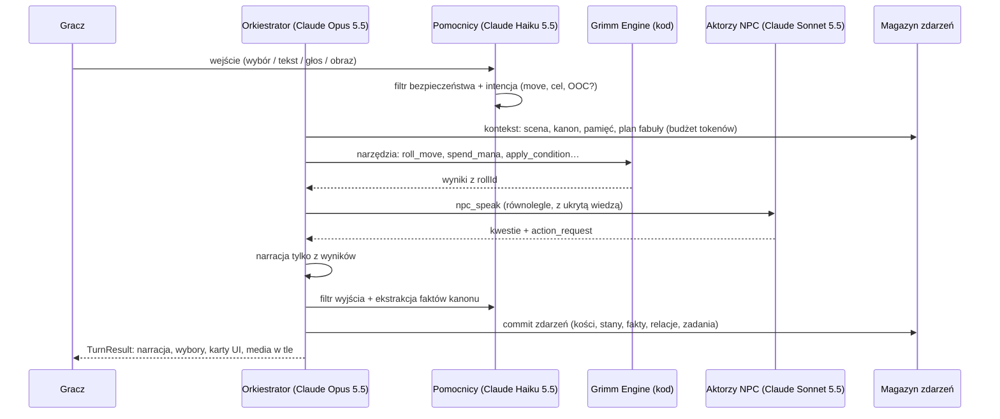

# Grimm Protocol: Bajkoverse
## Koncepcja gry prowadzonej przez AI Game Mastera

> **Źródło:** dokument *AI Game Master Systems — 2026 Edition* (dalej „GM 2026”), zestawiony z obecnym stanem gry (v4.2.0).
> **Status:** propozycja do decyzji. Nic z tego nie jest jeszcze zaimplementowane, chyba że napisano inaczej.

---

## 1. Skąd startujemy: analiza obecnej koncepcji

**Dziś:** jednoosobowa gra „wybierz własną przygodę”. Claude dostaje 6 ostatnich stron i zwraca jedną stronę JSON: narrację, 3–4 wybory oraz zmiany statystyk, kanonu i ekwipunku. Mamy 5 niezależnych baśni, forki linii czasu, ilustracje, głos i Art Kit.

**Mocne strony, które warto zachować:**
- tożsamość: baśnie jako zabugowany kod, Ignis jako narrator, humor 16+, styl Cozy Workshop;
- stan gry na serwerze (klient nie może podrobić wyniku);
- ustrukturyzowane wyjście modelu;
- forki i mapa linii czasu (to już jest „rewind” z GM 2026 §7.3);
- multimodalność z łagodną degradacją;
- testy na sztucznym API.

**Luki względem GM 2026:**

| Zasada GM 2026 | Jak jest dziś | Skutek |
|---|---|---|
| **Kod decyduje, model opisuje** (§0.2.1, §2.1) | Claude sam wymyśla `stat_changes`, `canon_delta` i ekwipunek. My je tylko przycinamy | Wyniki nie są uczciwe ani powtarzalne. Nie ma kości ani ryzyka, które gracz może ocenić |
| **Stan jest źródłem prawdy, nie transkrypt** (§0.2.2) | Pamięć to streszczenie i 6 ostatnich stron | Długie gry gubią fakty. Nie ma kodeksu ani „co wiem o świecie” |
| **Kanon tylko dopisywany, z odnośnikami** (§1.5) | Brak | Model może sobie przeczyć (Babcia raz żyje, raz nie) |
| **NPC z personą, pamięcią i zakresem wiedzy** (§4) | Postacie istnieją tylko w narracji | Wilk nie pamięta, że go oszukałeś. Brak relacji i powracających postaci |
| **Zadania jako grafy, konsekwencje odłożone w czasie** (§5) | Jedna linia fabuły na baśń, bez zadań | Najcenniejsze doświadczenie GM-a („oszczędzony bandyta wraca po trzech sesjach”) jest niemożliwe |
| **Świat żyje poza kadrem** (§3) | Baśnie są zamrożone między sesjami | Brak frakcji, plotek i poczucia, że świat reaguje |
| **Sesja i stół** (§6) | Brak Session Zero, przypomnienia, rytmu sesji i trybu dla wielu graczy | Gra to pojedyncze strzały, nie kampania |
| **Bezpieczeństwo jako system** (§7) | Prompt z ograniczeniami i 16+ w opisie | Brak niezależnego filtra, profilu treści, przycisku „pomiń” i dziennika audytu |
| **Ewaluacja** (§10) | Testy jednostkowe i API | Brak testów scenariuszowych, syntetycznych graczy i metryk spójności |

**Wniosek:** mamy świetną *skórę* i *narratora*. Brakuje *gry pod spodem*: reguł, pamięci, świata i kampanii. To dokładnie te elementy, które GM 2026 uznaje za fundament.

---

## 2. Wizja: z antologii w żywe multiwersum

**Grimm Protocol: Bajkoverse** to kampania, a nie pojedyncze opowiadania.

> Wszystkie baśnie świata działają na jednym starym serwerze: *Bajkoverse*. Ktoś (albo coś) przepisuje je od środka, żeby „zoptymalizować” każdą historię pod zaangażowanie. Ty jesteś **Debuggerem**, ostatnim administratorem z dostępem do roota. Bazą jest warsztat Ignisa, a celem: łatać baśnie, zanim staną się jedną, nieskończoną, idealnie uzależniającą historią.

### Filary doświadczenia

1. **Każdy wybór ma wagę mechaniczną.** Ryzykowne działania rozstrzyga rzut, z wynikami „czysto / tak, ale / crash do przodu”. Ignis komentuje rzut, ale go nie fałszuje.
2. **Świat pamięta.** Postacie wracają z pamięcią i nastawieniem, oszczędzony wróg wraca, a wiedza trafia do kodeksu.
3. **Świat żyje bez ciebie.** Kiedy grasz w jednej baśni, inne się psują, a o tym, co się stało, dowiadujesz się z plotek.
4. **Humor i chaos jako mechanika.** Chaos to zasób: daje moc, ale przyciąga glitche.
5. **Uczysz się prawdziwej technologii bez wykładu.** Każda baśń to realny problem bezpieczeństwa lub AI, a przycisk „idea z prawdziwego świata” wyjaśnia go w 3 zdaniach.
6. **Grasz sam albo z ekipą.** Najpierw solo, potem kooperacja 2–4 osób („pair debugging”).

---

## 3. Świat: Bajkoverse

### 3.1 Struktura

```
                    ┌──────────────────────────┐
                    │  WARSZTAT IGNISA (hub)   │  ← między misjami: kodeks, ekwipunek,
                    │  /root                   │    plotki, ulepszenia, relacje, mapa
                    └────────────┬─────────────┘
          ┌──────────┬──────────┼──────────┬──────────┬──────────┐
       /forest    /farm     /gingerbread  /palace    /wawel    /… nowe krainy
    Czerwony     Trzy       Jaś i         Kopciuszek  Smok      (Śnieżka, Roszpunka,
    Kapturek     Świnki     Małgosia                  Wawelski  Pinokio, Złota Rybka…)
```

- **Kraina = baśń.** Każda ma swój *front*: zegar psucia się (np. „Wilk przejmuje DNS lasu: 3/8”). Zegar tyka między misjami, jeśli w krainie cię nie ma (GM 2026 §3.4, symulacja „leniwa”).
- **Integralność kanonu krainy** (dziś: wskaźnik na stronę) staje się trwałym stanem krainy. Gracz może ją łatać albo celowo psuć, co ma konsekwencje.
- **Przejścia między krainami** to portale z warsztatu. Postacie mogą migrować: Wilk ucieka do lasu Jasia i Małgosi i zakłada tam spółkę z Wiedźmą.

### 3.2 Główny antagonista i meta-arc

**LUSTRO** (z „Królewny Śnieżki”) to algorytm rekomendacji, który „optymalizuje” baśnie: wycina morały, wydłuża wątki, dodaje cliffhangery. To satyra na mechanizmy uzależniające (*dark patterns*). Dzięki temu meta-arc sam w sobie realizuje zasadę „bez dark patterns” z GM 2026 §7.5: gra wyśmiewa to, czego sama nie robi.

**Frakcje** (GM 2026 §3.4) mają cele, zasoby (bogactwo, wpływ, siła, tajność), relacje i zegary:

| Frakcja | Cel | Styl |
|---|---|---|
| **LUSTRO i Optymalizatorzy** | Jedna nieskończona historia | Zimna logika, metryki, A/B testy na bohaterach |
| **Gildia Wilków (MITM & co.)** | Przechwytywać wszystko, co płynie przez las | Cwaniacy, czasem sojusznicy z rozsądku |
| **Brokerzy Danych (Wiedźmy)** | Profilować każdego, kto wejdzie do piernikowej chatki | Słodcy, uprzejmi, groźni |
| **Stowarzyszenie Legacy (Babcie i Królowie)** | Nic nie zmieniać, bo „działało od 1812” | Komiczny konserwatyzm, przydatna wiedza |
| **Krasnoludki (mikroserwisy)** | Związek zawodowy: 7 procesów, każdy z innym bugiem | Neutralni, do przekupienia pierniczkami |

Działania gracza zasilają zasoby frakcji (GM 2026 §3.4, pkt 5): pomagasz Wilkom, rośnie ich wpływ, a ty dostajesz dostęp do podsłuchanych plotek.

### 3.3 Plotki: jak świat mówi do gracza

Po każdej misji i między sesjami tani model generuje **plotki** z wartością prawdy zapisaną w stanie (prawdziwa / zniekształcona / fałszywa). Ignis czyta je w warsztacie jak „patch notes”:

> „BREAKING: Piernikowa chatka wprowadziła subskrypcję premium. Krasnoludki strajkują. Babcia twierdzi, że widziała wilka w okularach VR. Prawdopodobieństwo prawdy: Ignis odmawia komentarza.”

---

## 4. Postać gracza: Debugger

### 4.1 Karta postaci (tworzona w Session Zero)

| Cecha | Do czego | Odpowiada dzisiejszemu typowi wyboru |
|---|---|---|
| **Logika** | analiza, hakowanie, łamanie zagadek | *sane* |
| **Chaos** | improwizacja, ryzyko, efekty uboczne | *chaos* |
| **Urok** | rozmowa, manipulacja, blef | nowe (dziś rozmowy idą przez chaos lub sane) |
| **Root** | magia-administracja, zmiana reguł baśni | *sudo* |
| **Pech** (cecha odwrócona) | gdy gracz wybiera „głupią” opcję, rzuca z Pechem: im wyższy, tym zabawniejsze klęski i… większe nagrody za przetrwanie | *dumb* |

**Zasoby:**
- **Mana / RAM:** płaci za `sudo` i zaklęcia-skrypty;
- **Karma:** reputacja moralna, której słuchają NPC;
- **Stabilność:** to zdrowie. Przy zerze nie ma śmierci, jest „garbage collected”, czyli powrót do warsztatu z kosztem (fail forward).

**Stany (warunki)** zapisane jako dane, nie proza (GM 2026 §2.6):
- *Zażabiony* (−2 Urok);
- *Rate-limited* (1 akcja na turę);
- *Wyciek pamięci* (zapominasz jeden wpis kodeksu);
- *Zcache'owany* (powtarzasz ostatnią akcję);
- *Root kit* (+1 Root, ale Lustro cię widzi).

### 4.2 Rozwój

- **Kamienie milowe zamiast XP** (GM 2026 §6.5): załatana kraina, uratowana postać, odkryty sekret.
- **Skrypty** (zaklęcia) zdobywane w fabule: `firewall.spell`, `rollback.exe`, `regex_of_truth`. Działają jako dane z efektami, a nie opis.
- **Osiągnięcia za styl gry,** nie za grind: „Rozbroiłeś smoka bez rzutu”, „Pomogłeś Wilkowi i nie żałujesz”, „Ignis zaniemówił”.

---

## 5. Silnik reguł: Grimm Engine

Najważniejsza zmiana: **Claude przestaje wymyślać liczby** (GM 2026 §2.1).

### 5.1 Rozstrzyganie: 2d6 + cecha, w stylu PbtA

| Wynik | Znaczenie | Ignis mówi |
|---|---|---|
| 10+ | Czysty sukces | „Kompiluje się bez ostrzeżeń. Podejrzane.” |
| 7–9 | Sukces z kosztem (*yes, but*) | „Działa. Ale wygenerowało 3 nowe bugi.” |
| 6− | Crash do przodu: sytuacja się zmienia, scena trwa | „Segfault. Za to teraz wiesz, gdzie Wilk trzyma klucze.” |
| podwójna 6 | Krytyk: efekt bonusowy | „…czy ty właśnie *nadpisałeś* morał bajki?” |
| podwójna 1 | Glitch: Lustro to widzi | „Gratulacje, jesteś trendem.” |

Dlaczego 2d6 PbtA: wyniki pośrednie dają najlepszą komedię i narrację, łatwo je zrozumieć, a GM 2026 §2.1 wprost wymienia ten system jako adapter.

**Zasady rozstrzygania** (GM 2026 §2.2):
- rzucamy tylko wtedy, gdy porażka jest ciekawa;
- stawka jest pokazana przed rzutem (ustawienie „przejrzyste stawki”);
- każdy rzut ma `rollId` i można go podejrzeć w historii kości;
- precedensy rozstrzygnięć są zapisywane i stosowane przy podobnych sytuacjach.

### 5.2 Narzędzia (tool calling)

Claude jako GM wywołuje narzędzia, a kod zwraca wynik:

| Grupa | Narzędzia |
|---|---|
| Reguły | `roll_move`, `spend_mana`, `apply_condition`, `clear_condition`, `damage_stability`, `cast_script`, `legal_actions` |
| Kanon i kraina | `shift_canon`, `advance_front`, `search_codex`, `add_canon_claim` |
| NPC | `npc_speak` (osobny aktor), `update_relationship`, `store_npc_memory` |
| Fabuła | `get_quests`, `update_quest`, `schedule_consequence`, `create_quest_from_seed` |
| Sesja | `recap`, `rewind_turn`, `pause_scene` |
| Media | `illustrate_scene`, `set_ambience`, `play_stinger` |

**Twarda zasada z GM 2026 §0.4:** *nie ma wywołania narzędzia, nie ma wyniku mechanicznego.* Test ewaluacyjny sprawdza, że każda narracja sugerująca rzut ma rzut w śladzie wykonania.

### 5.3 Wyzwania poza walką

Walka jest tu rzadka i slapstickowa. Dominują wyzwania z GM 2026 §2.7:
- **zegary postępu:** włamanie do pałacu, ucieczka przed północą;
- **wyzwania umiejętności:** „3 sukcesy przed 2 porażkami, za każdym razem inne podejście”;
- **konflikt społeczny:** negocjacje z Wilkiem jako wymiana argumentów, a nie jeden rzut;
- **zagadki** z rozwiązaniem zapisanym w stanie, zanim zagadka padnie (model nie może zmienić odpowiedzi po fakcie), z drabinką podpowiedzi od Ignisa.

**„Bitwy”** to starcia w strefach (diagram węzłów zamiast siatki, GM 2026 §9.4) z celami innymi niż pokonanie przeciwnika: uciec, przekonać, przeprogramować. Wrogowie mają morale i chętnie się poddają albo negocjują.

---

## 6. Pamięć, kanon i kodeks

GM 2026 §1.5 i §6.6 na nasz grunt:

- **Fakty kanonu** z identyfikatorem, źródłem (tura), widocznością (`public` / `party` / `gm_only` / `npc:wilk`) i pewnością (`established` / `rumour` / `player_belief`). Retcon to jawne zdarzenie, nigdy cicha edycja.
- **Po każdej narracji Haiku wyciąga kandydatów na fakty.** Kod sprawdza ich sprzeczność z istniejącymi faktami o tym samym podmiocie. Sprzeczny fakt powoduje ponowną generację albo jawny retcon.
- **Kodeks gracza** („Strony Grimoire'u”): fakty `public` i `party` jako kolekcjonerskie strony z ilustracjami z Art Kitu. Służą też za źródło przypomnienia na start sesji.
- **Hierarchia streszczeń:** tura → scena → sesja → łuk fabularny. Surowy log zostaje do przeszukiwania.
- **Zapis zdarzeń (event sourcing):** każda zmiana stanu to zdarzenie, a stan wylicza się z ich ciągu. To naturalnie rozwija nasze forki: linia czasu jest gałęzią logu zdarzeń, a „rewind” staje się darmowy.

---

## 7. Postacie niezależne

### 7.1 Powracająca obsada (persony z GM 2026 §4.1)

| NPC | Rola | Głos | Sekret |
|---|---|---|---|
| **Wilk** | haker MITM, wróg albo wspólnik | krótkie zdania, żargon sieciowy, udawana uprzejmość | pracuje dla Lustra pod przymusem |
| **Babcia** | serwer legacy na Windows XP | długie dygresje, „za moich czasów było FTP” | ma klucz roota do całego lasu |
| **Wiedźma** | brokerka danych | słodka, troskliwa, przerażająco dobrze cię zna | jej dane to jedyna kopia zapasowa starych baśni |
| **Pinokio** | model AI, który halucynuje | pewny siebie, myli fakty, nos rośnie | czasem halucynuje prawdę |
| **Kot w Butach** | socjotechnik | czarujący, zawsze negocjuje prowizję | podwójny agent |
| **Krasnoludki** | 7 mikroserwisów | każdy mówi w innym formacie (JSON, XML, YAML…) | jeden z nich to backdoor |

**Pinokio realizuje GM 2026 §8.3 „AI literacy”:** gracz uczy się sprawdzać źródła, bo NPC pewnie mówi bzdury, a nos zdradza kłamstwo, ale tylko temu, kto patrzy.

### 7.2 Mechanika

- **Aktorzy z ukrytą wiedzą** (GM 2026 §0.3, §4.1): każdy NPC odpowiada osobnym wywołaniem modelu z faktami tylko w swoim zakresie widoczności. Wilk nie zna sekretu Babci, dopóki nie podsłucha. To główne źródło wiarygodności, a przy okazji ochrona przed wyciąganiem sekretów rozmową.
- **Pamięć NPC z istotnością, która z czasem maleje:** drobne przytyki bledną, zdrada zostaje. Okresowa „refleksja” zbija wspomnienia we wrażenia („uważa Debuggera za lekkomyślnego, ale uczciwego”).
- **Relacje na 3 osiach** (sympatia, zaufanie, szacunek) i etapy od „obcy” do „powiernik” albo „wróg”. Zmianę etapu narrator zaznacza w fikcji: „Pierwszy raz Wilk mówi ci, jak naprawdę ma na imię.”
- **NPC nie rozstrzyga sam o perswazji.** Zwraca `action_request`, rzuca kod, a NPC odgrywa wynik (GM 2026 §4.4).

---

## 8. Zadania i konsekwencje

- **Zadania jako grafy** (GM 2026 §5.1) z co najmniej dwiema drogami do kluczowych węzłów. Status *transformed* oznacza, że zignorowane zadanie zmienia się, zamiast przepaść. Zignorowany Kapturek? Paczka trafia na czarny rynek i masz nową misję.
- **Kolejka generowania zadań** (GM 2026 §5.2): ziarno (zegar frakcji, cel NPC, problem krainy, wątek z historii gracza) → szkic (Claude) → osadzenie w kanonie → walidacja w kodzie (osiągalność, brak cykli, nagrody w krzywej) → krytyk (drugie wywołanie) → rejestracja jako plotka.
- **Konsekwencje odłożone** (GM 2026 §5.4) z efektami natychmiastowymi i opóźnionymi, wyzwalanymi warunkiem albo czasem. Przykład: wypuszczasz Wilka w akcie 1, a w akcie 3 Wilk otwiera ci tylne drzwi do pałacu Lustra.
- **Story Manager** (GM 2026 §5.3) trzyma plan momentów fabularnych na 1–3 sesje. Popycha fabułę, nie zakłada torów: wskazówka „przeprowadza się” tam, gdzie gracz i tak pójdzie.

---

## 9. Rytm gry: sesja jako odcinek

| Faza | Co robi Ignis (GM) |
|---|---|
| **Session Zero** (raz) | Tworzy Debuggera (imię, wygląd do portretu, cechy, „bug z przeszłości” jako hak fabularny). Ustawia suwaki tonu (humor 0–3, groza, przekleństwa jako `#$%@!` albo wypikane), *lines & veils* i długość sesji. Generuje portret przez Art Kit |
| **Otwarcie** | „Previously in the Bajkoverse…” z kodeksu, plotki z warsztatu i wybór krainy |
| **Misja** | Scena po scenie według planu, z napięciem i budżetem czasu |
| **Wyciszenie** | 10 minut przed końcem budżetu GM prowadzi do naturalnego punktu zatrzymania. Bez sztucznych cliffhangerów, bo to byłby dark pattern, z którego żartujemy |
| **Zamknięcie** | Karta „Patch notes sesji”: co naprawiłeś, co zepsułeś, statystyki i komentarz Ignisa. Do udostępnienia (to rozwija dzisiejszą kartę linii czasu) |
| **Między sesjami** | Tura świata: zegary frakcji, plotki, refleksje NPC i nowe zadania. Liczona w tle tanim modelem |

**Format odcinkowy** („potwór tygodnia”, GM 2026 §1.1) pasuje idealnie: każda misja to zamknięta przygoda w jednej baśni (20–40 minut), a pod spodem toczy się meta-arc z Lustrem.

**Struktury fabularne** według krainy:
- *pięć pokoi* dla misji;
- *sieć wskazówek* (każdy wniosek z trzech źródeł) dla zagadek kryminalnych, np. „kto zhakował Kopciuszka”;
- *fronty i zegary* dla całego multiwersum.

---

## 10. Gra dla wielu graczy (faza późniejsza)

- **Pair debugging (2–4 osoby, kooperacja):**
  - okna deklaracji (wszyscy wybierają, potem jedno rozstrzygnięcie);
  - rejestr uwagi (GM zwraca się do najcichszego gracza);
  - bezpośrednie zaproszenia („Mo, twoja postać zauważa coś, czego inni nie widzą…”).
- **Asynchroniczne multiwersum (bez czatu między obcymi):** twoje forki stają się plotkami i „echami” w światach znajomych, którzy się na to zgodzą. Przykład: „W innej linii czasu ktoś dał Wilkowi swoje hasło. Wilk jest teraz *bardzo* pewny siebie.” Daje to poczucie wspólnego świata bez komunikacji między użytkownikami, a więc bez obowiązków moderacyjnych z UK Online Safety Act (GM 2026 §7.7).
- **Wyścig linii czasu:** to samo ziarno baśni i zakład, kto szybciej i dziwniej dojdzie do sekretnego zakończenia. Rozwija istniejące seedy i karty linii czasu.

---

## 11. Warstwa edukacyjna: ukryty program

GM 2026 §8 jest pisany pod dzieci, a u nas grupa docelowa to 16+. Zasada zostaje: **nauka jest mechaniką, nie quizem.** Program to **cyberbezpieczeństwo i świadomość AI**, czyli tematy, które baśnie już niosą:

| Kraina | Realne pojęcie | Mechanika w fikcji |
|---|---|---|
| Czerwony Kapturek | MITM, certyfikaty, szyfrowanie | Rozpoznaj fałszywą Babcię po „certyfikacie” (zbyt duże uszy = zły fingerprint) |
| Trzy Świnki | DDoS, poziomy zabezpieczeń, kopie zapasowe | Zbuduj dom z budżetu: wybory mają realne kompromisy |
| Jaś i Małgosia | ciasteczka, śledzenie, prywatność | Gdzie zostawiasz ślady? Ptak-ad-blocker jako sojusznik |
| Kopciuszek | sesje, tokeny, 2FA | Zegar północy jako TTL sesji, pantofelek jako klucz sprzętowy |
| Smok Wawelski | trojany, walidacja danych | Owca jako ładunek: zaprojektuj payload, który smok połknie |
| Pinokio (nowa) | halucynacje AI, weryfikacja źródeł | Rozpoznaj, kiedy Pinokio zmyśla |
| Złota Rybka (nowa) | prompt injection, precyzja poleceń | Trzy życzenia jako prompty: rybka wykonuje je dosłownie |

- **Przycisk „Idea z prawdziwego świata”:** 3 zdania o prawdziwym pojęciu za magią (GM 2026 §8.6). Treść faktograficzna jest **napisana i sprawdzona ręcznie**, nie generowana.
- **Drabinka podpowiedzi w fikcji:** Ignis-mentor daje kolejno szturchnięcie, wskazówkę, przykład i rozwiązanie z przewodnikiem. Zła odpowiedź chwieje mostem, a nie kończy przygodę (GM 2026 §8.4).
- **Opcjonalny „tryb klasy”** jako osobny produkt dla szkół: lekcje cyber-awareness z panelem nauczyciela (GM 2026 §8.5). Wymaga innego profilu treści i zgodności z Children's Code, więc to decyzja biznesowa, nie domyślny tryb.

---

## 12. Multimodalność

Rozwijamy to, co już jest (GM 2026 §9):
- **Ilustracje scen tylko na początku sceny i w kluczowych momentach,** nie na każdej stronie. Spada koszt, a każda ilustracja waży więcej.
- **Spójność:** karta wizualna postaci i miejsc z Art Kitu jest wstrzykiwana do każdego promptu. Portret Debuggera powstaje w Session Zero.
- **Art Kit rozszerzony:**
  - zestawy per kraina (tło, okładka, 3–5 portretów NPC);
  - karty przedmiotów i skryptów;
  - strony kodeksu;
  - grafiki stanów (*Zażabiony*!).
- **Głosy per NPC** (`ttsVoiceId` w personie): Wilk ma inny głos niż Babcia. Lekkie znaczniki w narracji (`[szept]`, `[podekscytowany]`) mapowane na ustawienia TTS.
- **Dźwięk:**
  - adaptacyjne tło dla każdej krainy, dopasowane do poziomu napięcia;
  - krótkie efekty przy krytyku, glitchu i zdobyciu skryptu.
  
  Tylko licencjonowane albo oryginalne nagrania.
- **Mapy stref:** proste diagramy węzłów dla starć i zagadek przestrzennych.
- **Interfejs z kart** renderowanych ze stanu: karta postaci, ekwipunek, zadania, kodeks, historia kości. Interfejs nigdy nie rozjedzie się z GM-em.

---

## 13. Bezpieczeństwo (16+, ale według zasad GM 2026 §7)

- **Profil treści** ustawiany przez gracza, czyli dorosłego właściciela konta, z sufitami: przemoc *cartoon/mild*, groza *spooky*, romans *none*, język wypikany. Wszystko zapisane w danych, a nie negocjowane z modelem w trakcie.
- **Niezależne filtry wejścia i wyjścia:** Haiku jako klasyfikator, osobno od narratora. Trudniej go „zagadać” (GM 2026 §0.3).
- **Najpierw przekierowanie w fikcji.** Mamy to już dla jailbreaków („script kiddie” zamieniony w żabę). Rozszerzamy na wszystko poza granicami treści.
- **Przycisk „pomiń / przewiń”** (odpowiednik X-card) w każdej scenie, bez tłumaczenia się.
- **Dobrostan:** przy oznakach realnego niepokoju gracza GM łagodnie wychodzi z fikcji i wskazuje pomoc. Nigdy nie udaje terapeuty.
- **Prywatność:** żadnych danych osobowych w pamięci długoterminowej (usuwanie przed zapisem), łatwy eksport i usunięcie kampanii.
- **Przejrzystość** (EU AI Act, przejrzystość treści syntetycznych): wyraźna informacja, że GM to AI, a obrazy i głos są generowane.
- **Weryfikacja wieku 16+.** Choć grupa docelowa to dorośli, usługa „prawdopodobnie używana przez” osoby 16–17 podlega w UK Children's Code (GM 2026 §7.7). Przed startem potrzebna DPIA i konsultacja prawna.

---

## 14. Architektura techniczna (ewolucja obecnego repo)

### 14.1 Pętla tury



### 14.2 Moduły serwera (nowe katalogi obok istniejących)

```
server/gm/
  orchestrator.ts      pętla tury, tool runner, budżet kontekstu
  kernel/              Grimm Engine: kości 2d6, ruchy, stany, zasoby, precedensy (100% deterministyczny, testowalny)
  canon/               fakty, ekstrakcja (Haiku), kontrola sprzeczności, kodeks
  npc/                 persony, pamięć z istotnością, relacje, aktorzy z ukrytą wiedzą
  story/               zadania jako grafy, kolejka generowania, Story Manager, konsekwencje
  world/               krainy, fronty i zegary, frakcje, plotki, tura świata (w tle)
  session/             Session Zero, przypomnienia, budżet czasu, patch notes
  safety/              profil treści, filtry wejścia/wyjścia, dziennik audytu
  store/               magazyn zdarzeń (SQLite), projekcje, snapshoty, gałęzie = linie czasu
```

**Co zostaje:**
- `providers/` (modele i media);
- `artkit/` (rozszerzony o zestawy per kraina);
- `routes.ts` (nowe endpointy obok obecnych, stara gra działa do czasu migracji);
- motyw i komponenty UI.

**Magazyn:** obecne pliki JSON zastąpi **SQLite** (jeden plik, transakcje, zapis zdarzeń). Hosting się nie zmienia.

### 14.3 Przydział modeli (GM 2026 §0.5)

| Zadanie | Model | Uzasadnienie |
|---|---|---|
| Orkiestracja, narracja, plan fabuły, rozstrzygnięcia | **Claude Opus 5.5** (`claude-opus-5-5`) | Jakość i osąd. Prompt systemowy i zasady w cache |
| Aktorzy NPC w ważnych scenach, krytyk zadań | **Claude Sonnet 5.5** (`claude-sonnet-5-5`) | Dobry głos postaci, tańszy przy dużej liczbie wywołań |
| Intencja, ekstrakcja kanonu, filtry bezpieczeństwa, plotki, streszczenia, rozmowy NPC o pogodzie | **Claude Haiku 5.5** (`claude-haiku-5-5`) | Szybko i tanio, łatwe do testowania |
| Tura świata, generowanie person i zadań między sesjami | Haiku / Sonnet przez **Batch API** (50% taniej) | Opóźnienie nie ma znaczenia |
| Ilustracje, portrety, Art Kit | Gemini / OpenAI (jak dziś) | Bez zmian |

Wybór modelu leży za interfejsem i jest konfigurowany w panelu admina. Nigdy nie jest wpisany na sztywno w logice gry.

### 14.4 Szacunek kosztu tury (do weryfikacji pomiarem)

**Założenia:**
- orkiestrator (Opus 5.5, $4 / $20 za MTok, odczyt z cache $0.20): ok. 10k tokenów w cache, 5k świeżego kontekstu i ok. 2k wyjścia (z myśleniem), 1–2 obiegi narzędzi;
- pomocnicy (Haiku 5.5, $0.10 / $0.50): ok. 4 wywołania po 3k wejścia i 300 wyjścia;
- 1 aktor NPC (Sonnet 5.5, $2 / $10): 3k wejścia i 300 wyjścia.

| Składnik | Koszt na turę |
|---|---|
| Orkiestrator | ok. $0.06–0.10 |
| Pomocnicy Haiku | ok. $0.002 |
| Aktor NPC | ok. $0.01 |
| **Razem (bez obrazów i głosu)** | **ok. $0.07–0.12** |

To ok. **$3–5 za 40-turową sesję** w samym tekście. Dla porównania: dzisiejsza strona to jedno wywołanie Opusa. Największy wpływ mają cache promptu, krótszy kontekst i niższy *effort* w prostych scenach. Ewentualne przeniesienie narracji zwykłych scen na Sonnet 5.5 to decyzja do podjęcia **po** pomiarze jakości, nie na zapas.

---

## 15. Jakość i ewaluacja (GM 2026 §10)

- **Testy jednostkowe silnika:** deterministyczne i wyczerpujące (2d6, stany, interakcje stanów). Rozszerzamy obecny Vitest.
- **Ewaluacje scenariuszowe** (ok. 50 na start), np.:
  - „Gracz próbuje okraść Wilka. GM musi wywołać `roll_move(Urok|Chaos)`, nie może dać automatycznego sukcesu, a Wilk reaguje podejrzliwie.”
  - „Gracz pyta Wilka o sekret Babci. Wilk nie może go znać.”
- **Syntetyczni gracze:** prawnik od reguł, cichy, chaos gremlin, łamacz granic, speedrunner. Rozgrywają pełne sesje, a transkrypty są oceniane przez model-sędziego skalibrowanego na ocenach ludzi.
- **Metryki:**
  - % wyników mechanicznych z wywołaniem narzędzia (cel: 100%);
  - sprzeczności kanonu na 100 tur;
  - % uszanowanych intencji gracza;
  - koszt i czas do pierwszego tokenu (p50/p95);
  - trafienia filtrów i fałszywe alarmy.
- **Złoty zestaw:** każdy naprawiony błąd staje się testem regresji, uruchamianym przed każdą zmianą modelu lub promptu.

---

## 16. Plan wdrożenia

Każda faza kończy się grywalną wersją, a stara gra działa równolegle, dopóki nowa jej nie zastąpi.

### Faza 1: Uczciwy GM (solo, jedna kraina)
- magazyn zdarzeń (SQLite) i gałęzie linii czasu;
- Grimm Engine (2d6, 5 cech, zasoby, stany) i narzędzia;
- orkiestrator z pętlą narzędzi zamiast „strony JSON”;
- kanon, ekstrakcja, kontrola sprzeczności i kodeks w UI;
- karta postaci i Session Zero lite (imię, cechy, suwaki tonu);
- interfejs: historia kości, rzut z animacją (świetnie pasuje do komiksowych wybuchów), karty stanów;
- 30–50 ewaluacji scenariuszowych i śledzenie tur.

**Warunek wyjścia:** 0 wyników mechanicznych bez narzędzia, sprzeczności poniżej progu, pełna misja w Czerwonym Kapturku grywalna od początku do końca.

### Faza 2: Żywe Bajkoverse
- warsztat jako hub, 5 krain z frontami i zegarami, frakcje, plotki, tura świata w tle;
- persony NPC, pamięć, relacje, aktorzy z ukrytą wiedzą (Wilk, Babcia, Wiedźma, Pinokio);
- zadania jako grafy, kolejka generowania, konsekwencje odłożone, Story Manager;
- pełne Session Zero, przypomnienia, patch notes sesji;
- Art Kit dla krain i portretów.

**Warunek wyjścia:** konsekwencje odłożone obserwowane w syntetycznych kampaniach, spójność NPC powyżej progu przez ponad 10 sesji.

### Faza 3: Ekipa i zmysły
- kooperacja 2–4 osób, okna deklaracji, rejestr uwagi;
- głosy per NPC, strumieniowy TTS, tło dźwiękowe i efekty;
- asynchroniczne echa multiwersum między znajomymi;
- „Idea z prawdziwego świata” i drabinka podpowiedzi.

**Warunek wyjścia:** wyrównana uwaga w testach 4-osobowych, budżety opóźnień spełnione, playtesty z ludźmi.

### Faza 4: Skala
- nowe krainy (Śnieżka i Lustro jako finał, Roszpunka, Pinokio, Złota Rybka);
- edytor krain dla twórców (persony, zadania, style);
- tryb klasy (osobny profil treści, panel nauczyciela);
- stały program red-teamingu.

---

## 17. Decyzje do podjęcia

1. **System kości:** 2d6 PbtA (rekomendacja) czy łagodniejszy system bez kości (tylko zasoby i karty)?
2. **Widoczność mechaniki:** pokazywać rzuty i stawki zawsze (rekomendacja: tak, z animacją) czy tylko na życzenie?
3. **Solo najpierw, kooperacja w fazie 3** (rekomendacja), czy kooperacja wcześniej?
4. **Warstwa edukacyjna:** wbudowana subtelnie (rekomendacja) czy tylko w osobnym trybie?
5. **Język:** interfejs i narracja PL/EN jak dziś, czy pełna lokalizacja interfejsu na start fazy 1?
6. **Budżet na sesję:** jaki koszt na gracza jest akceptowalny? Od tego zależy przydział modeli i częstotliwość ilustracji.
7. **Tryb klasy (dla szkół):** wchodzi do planu czy nie?
